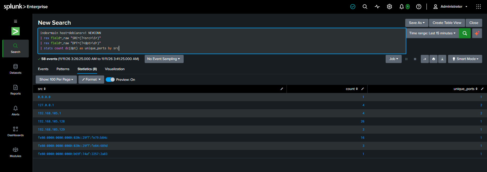
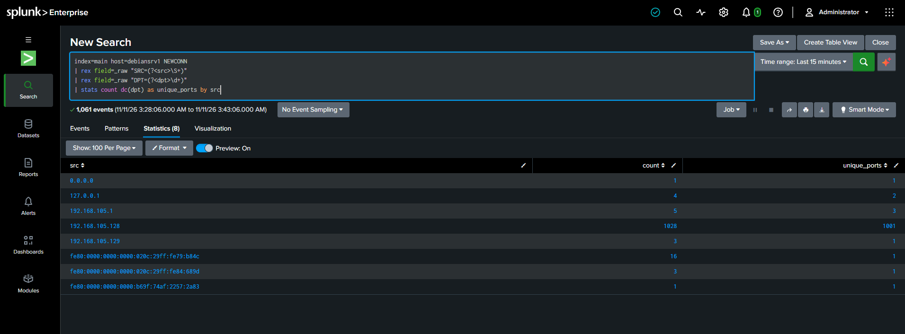
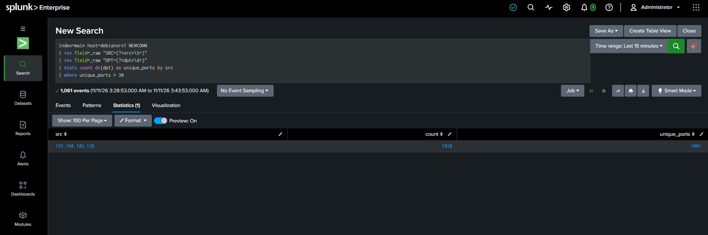

# Lab 1: Nmap Port Scan Detection

## Goal
Detect port scanning activity (MITRE T1046 — Network Service Discovery) by identifying a single source touching an abnormally high number of distinct ports in a short window.

## Setup
Linux doesn't log connection attempts by default, there's no out-of-the-box source for this. A logging rule had to be created first.

**1. nftables logging rule** (victim machine), logs every new inbound connection without blocking anything:
```bash
sudo nft add table inet lab
sudo nft add chain inet lab input '{ type filter hook input priority 0; policy accept; }'
sudo nft 'add rule inet lab input ct state new log prefix "NEWCONN "'
```
> nftables rules are runtime-only and don't survive a reboot — saved as `lab-nft.sh`, re-run after every VM restart.

**2. Splunk journald input.** The forwarder's user needs journal read access first:
```bash
sudo usermod -aG systemd-journal splunkfwd
sudo mkdir -p /opt/splunkforwarder/etc/apps/journald_input/local
sudo nano /opt/splunkforwarder/etc/apps/journald_input/local/inputs.conf
```
Add this stanza:
```ini
[journald://nmap-lab]
journalctl-filter = _TRANSPORT=kernel
journalctl-grep = NEWCONN IN=
index = main
```
Restart as a service:
```bash
sudo systemctl restart SplunkForwarder
```

## The Attack
From the attacker machine:
```bash
nmap <victim-ip>
```
Default nmap scans the 1000 most common TCP ports in under 2 seconds.

## Baseline
Before the attack, normal background traffic (mDNS, NetBIOS broadcasts) never touched more than **3 distinct ports** from any single source.

## Detection
```spl
index=main host=<victim-host> NEWCONN
| rex field=_raw "SRC=(?<src>\S+)"
| rex field=_raw "DPT=(?<dpt>\d+)"
| stats count dc(dpt) as unique_ports by src
| where unique_ports > 30
```

## Evidence




## Tuning
- First threshold attempt: `> 400`. **Failed** against `nmap -F` (fast scan, 100 ports) — the attacker's row didn't appear.
- Lowered to `> 30`: well above the observed baseline (3), comfortably below even a fast scan (100). Retested against `nmap -F` — correctly flagged this time.
- **Known gap:** detection counts over the whole search window, not a rolling window. A slow scan spread across hours could stay under threshold. A `bin _time span=1m` rolling-window version would close this but wasn't implemented here.

## MITRE ATT&CK
**T1046 — Network Service Discovery**

## What I Learned
- Not every attack has a ready-made log source; sometimes you have to build the visibility yourself before you can detect anything.
- A threshold that looks reasonable on paper should still be tested against a realistic attack variant, not just the first one tried.