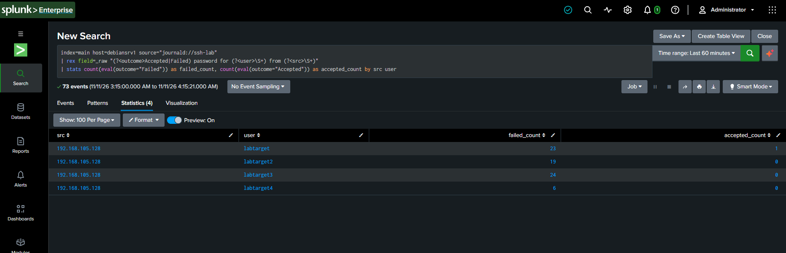
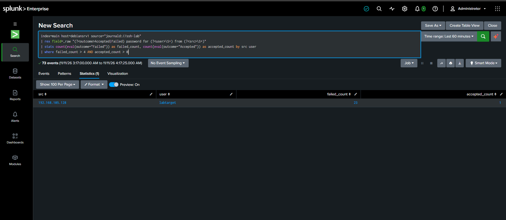

# Lab 2: SSH Brute Force Detection

## Goal
Detect a successful brute-force login (MITRE T1110 — Brute Force) by identifying an account that received many failed password attempts followed by a successful one,
 from the same source.

## Setup
SSH already logs every login attempt, no custom logging rule needed here, just an input pointed at the right service.

**1. Install and start SSH** (victim machine, not installed by default on a minimal image):
```bash
sudo apt install openssh-server -y
```

**2. Create a throwaway target account**, so the attack never touches a real login:
```bash
sudo adduser labtarget
```

**3. Splunk journald input**, filtered to the SSH service, keeping only pass/fail lines:
```bash
sudo nano /opt/splunkforwarder/etc/apps/journald_input/local/inputs.conf
```
Added as a second stanza, alongside the nmap one in the same file:
```ini
[journald://ssh-lab]
journalctl-unit = ssh
journalctl-grep = Failed password|Accepted password
index = main
```
```bash
sudo systemctl restart SplunkForwarder
```

## The Attack
A Python script (`paramiko`) attacked four throwaway accounts: three received only random, incorrect password guesses (10-15 attempts each),
 one (`labtarget`) received the same random guesses followed by its real password, guaranteeing one successful breach to detect.

```bash
pip3 install paramiko
python3 ssh_brute.py
```

> **Note:** the first run failed entirely, every connection was dropped with `Connection reset by peer`.
 This was OpenSSH's own `MaxStartups` protection rejecting too many simultaneous unauthenticated connections. 
 Fixed by adding a 1-second delay between attempts in the script, a real anti-automation defense encountered and worked around.

## Detection
```spl
index=main host=<victim-host> source="journald://ssh-lab"
| rex field=_raw "(?<outcome>Accepted|Failed) password for (?<user>\S+) from (?<src>\S+)"
| stats count(eval(outcome="Failed")) as failed_count, count(eval(outcome="Accepted")) as accepted_count by src user
| where failed_count > 4 AND accepted_count > 0
```

## Evidence



## Tuning
- Threshold set at `failed_count > 4`: reasoning is behavioral, not arbitrary — a legitimate user mistyping a password happens once or twice;
 by the fourth failure in a row, a password reset is the normal next step, not another guess. Four or more failures is treated as abnormal.
- `AND accepted_count > 0` is the key condition distinguishing this from a simple failed-login counter: it isolates accounts that were both hammered *and* actually compromised,
 not just probed. Two other accounts in testing received 7 and 5 failed attempts respectively but were never flagged, since they were never actually breached.

## MITRE ATT&CK
**T1110 — Brute Force**

## What I Learned
- A live service's built-in defenses (SSH's `MaxStartups`) can interfere with testing, worth expecting and working around rather than treating as a bug.
- Counting failures alone isn't the real signal; a *successful* login after repeated failures is what actually matters operationally.